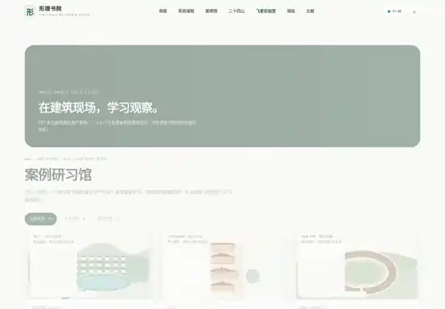
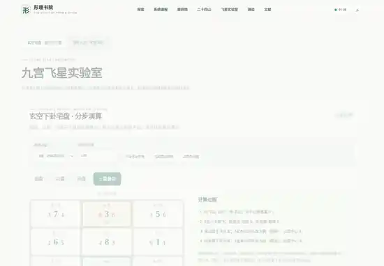

<div align="center">


# 形理书院 · Xingli Academy

**观山川之形，究方位之理。**

个人学习中国传统风水文化时，用 **Vibe Coding** 做出来的交互式学习网站。

[**在线体验**](https://scorpion-z.github.io/xingli-academy/) · [功能介绍](#主要功能) · [快速开始](#快速开始) · [问题反馈](https://github.com/Scorpion-Z/xingli-academy/issues)


</div>


## 项目介绍

最近在学习二十四山、玄空飞星、排龙诀以及传统建筑空间布局。查阅资料时，经常需要对照罗盘和图解，因此把课程笔记、公开资料与简单的计算练习做成了一个网站，方便自己理解和复习。

我仍然是初学者。项目采用 **Vibe Coding** 的方式开发，由我整理需求、体验功能和校对学习内容，借助 AI 完成主要的页面与交互代码。课程和算法会继续完善，也欢迎指正。

**当前版本：V5.0.1**。这一版整合了导航入口，工具集中在「工具箱」，避免课程与实验室在顶部重复出现。

## 主要功能

| 功能 | 内容 |
| --- | --- |
| 系统课程 | 6 个阶段、36 节课程，配有知识图解与学习任务 |
| 课程测验 | 108 道课内题目，记录学习进度 |
| 案例研习 | 30 个案例，其中 4 个真实建筑文化案例、26 个模拟练习 |
| **二十四山罗盘** | 角度与山位识别、八卦及三元龙图层、边界提示与练习 |
| **玄空飞星** | 运盘、山盘、向盘的分步教学推演与流年九宫演示 |
| **平面图分析** | 导入户型图、校准北向、叠加九宫、保存练习及导出报告 |
| 图像与文献 | 历史图版、建筑照片、传统术语及资料来源 |
| 学习记录 | 浏览器本地保存、手动备份与恢复 |

主导航统一为：**探索 · 系统课程 · 案例馆 · 工具箱 · 测验 · 文献**。三个专业实验室都可以从「工具箱」打开。

## 页面预览

以下截图记录了网站迭代中的部分页面。最新的 V5.0.1 页面与工具箱布局以 [在线版本](https://scorpion-z.github.io/xingli-academy/) 为准。

| 首页 | 课程学习 |
| :---: | :---: |
|  |  |
| 案例研习 | 飞星工具 |
|  |  |

## 快速开始

### 在线访问

直接打开 [**形理书院**](https://scorpion-z.github.io/xingli-academy/)，无需登录，也无需安装软件。

### 本地运行

```bash
git clone https://github.com/Scorpion-Z/xingli-academy.git
cd xingli-academy
```

使用 Chrome、Edge 或 Safari 打开根目录的 `index.html`。

这个仓库发布的是可以直接使用的静态页面，**不需要 Node.js、数据库或后端服务**。部署使用 GitHub Pages，根目录包含 `index.html` 和 `.nojekyll`。

## 学习路线

| 阶段 | 主要内容 |
| --- | --- |
| 01 基础入门 | 阴阳五行、八卦、天干地支、二十四山 |
| 02 形势观察 | 龙、穴、砂、水、向与建筑环境 |
| 03 理气基础 | 河图洛书、九宫、九星、三元九运 |
| 04 玄空飞星 | 运盘、山盘、向盘与基础推演 |
| 05 排龙专题 | 来龙、阴阳顺逆、排龙图与流派差异 |
| 06 综合研习 | 传统建筑、住宅与办公空间的观察练习 |

## 技术与数据

网站主要使用原生 **HTML、CSS、JavaScript 和 SVG**。当前线上版本将主要页面代码合并为单个 `index.html`，方便静态发布。

学习记录和户型练习项目主要保存在浏览器本地。平面图可能含有个人住宅信息，**请谨慎分享导出的 JSON 和 PNG 文件**。浏览器存储有清理或隔离的可能，重要练习建议定期导出备份。

部分历史资料与建筑摄影依赖第三方图片资源，需要联网加载，版权与使用许可以原始来源为准。

## 后续计划

- [ ] 补充更充分的高清历史资料和有来源的建筑实景
- [ ] 增加与课程对应的动手练习、错题讲解和案例复盘
- [ ] 扩充经过文献复核的排盘实例
- [ ] 改善移动端的图像标注和大图查看体验
- [ ] 持续整理模块化源码和自动化测试

## 反馈与说明

欢迎通过 [Issues](https://github.com/Scorpion-Z/xingli-academy/issues) 提出建议或指出课程错误，尽量附上具体页面与复现步骤。

这只是一个个人兴趣学习项目。风水术数中的吉凶、财运等推演缺乏充分的现代科学证据，不宜用作建筑安全、健康、财务等专业决策依据。特殊替卦、兼向与部分排龙流派算法仍有待完善。

仓库目前没有独立的开源许可证。公开展示代码不等于授权自由复制、修改或再分发。

---

<div align="center">

**形理书院 · Xingli Academy**

[访问网站](https://scorpion-z.github.io/xingli-academy/) · [反馈问题](https://github.com/Scorpion-Z/xingli-academy/issues)

</div>
